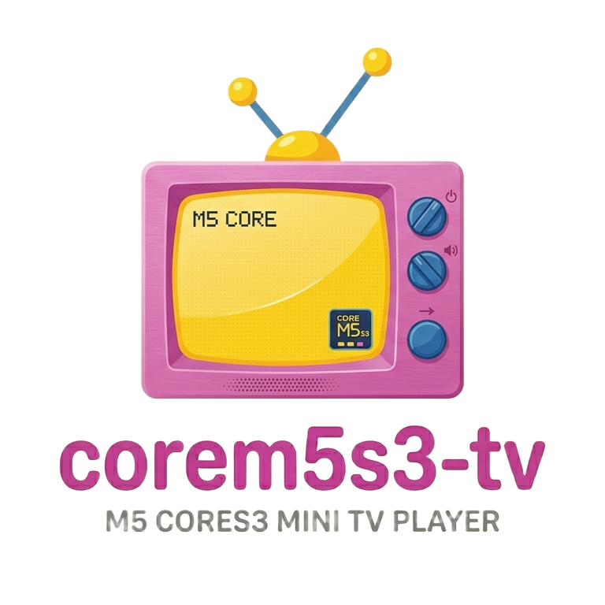

# CoreM5S3 TV



Turn your ESP32-S3-based board into a standalone retro TV that plays episodes with a CRT-like experience. No menus, no navigation — just power on and watch.

## Supported Hardware

### M5Stack CoreS3 SE
- **Display:** 2.0" IPS 320×240 ILI9342C (SPI)
- **Audio:** AW88298 I2S amp + 1 W speaker
- **SD:** SPI mode (CS=4, MOSI=37, MISO=35, SCK=36)

### Waveshare ESP32-S3-Touch-LCD-1.54
- **Display:** 1.54" IPS 240×240 ST7789V2 (SPI)
- **Audio:** ES8311 DAC + NS4150B amp (3W mono)
- **SD:** SD_MMC 4-bit mode (CLK=16, CMD=15, D0=17, D1=18, D2=13, D3=14)
- **Touch:** CST816T capacitive (GPIO42/41 I2C)
- **Buttons:** BOOT/- (GPIO0), PWR (GPIO5), +/Key (GPIO4)

## Quick Start

```bash
# 1. Convert episodes (--board sets the resolution: waveshare/generic = 240×240, m5stack = 320×240)
python3 tools/convert_episodes.py --input ~/Videos/Simpsons --output /Volumes/SDCARD --board waveshare

# 2. Build and flash firmware (select your board)
cd firmware
pio run -e waveshare-s3-touch-lcd-154 --target upload   # Waveshare
pio run -e m5stack-cores3-se --target upload              # M5Stack CoreS3 SE

# 3. Insert SD card, power on
```

## How It Works

```
Video file (.mp4/.mkv)
         │
         ├── ffmpeg ──► .mjpeg (sequential JPEG frames with size prefix)
         │
         └── ffmpeg ──► .pcm (raw 16-bit mono PCM audio)
                                  │
SD Card ──► ESP32-S3 ──► MJPEG decode (JPEGDEC lib)
                            ├── Push to display @ 240×240 or 320×240 (SPI)
                            └── Audio sync via I2S → speaker
```

### File Format

**`.mjpeg`** — Custom format: a 16-byte header followed by `[4-byte frame size][JPEG data]...` repeated (odd-sized frames are padded to an even size). No index — just sequential frames until EOF.

| Offset | Size | Field |
|--------|------|-------|
| 0 | 4 | Magic `CMTV` |
| 4 | 1 | Header version (`1`) |
| 5 | 1 | Reserved (`0`) |
| 6 | 2 | FPS |
| 8 | 2 | Width |
| 10 | 2 | Height |
| 12 | 4 | PCM sample rate (Hz) |

All fields are little-endian. The firmware paces playback with the FPS from the header, warns (and crops) if the size doesn't match the display, and refuses the audio if the sample rate isn't 44,100 Hz. Files converted before the header existed still play, assuming 15 FPS.

**`.pcm`** — Raw PCM: 44,100 Hz, 16-bit signed, mono, little-endian. No header.

### Pipeline

| Step | Time (approx) | Core |
|------|---------------|------|
| Read JPEG from SD (SPI) | ~2 ms | 1 |
| Decode JPEG (JPEGDEC) | ~55 ms | 1 |
| Push to display (SPI) | ~5 ms | 1 |
| I2S audio DMA | 0 ms (background) | 0 |
| **Total per frame** | **~62 ms** | |
| **Sustained FPS** | **15** | |

## Storage Estimates

| Item | Per 22-min episode (320×240) | Per 22-min episode (240×240) |
|------|-------------------|-------------------|
| Video (15 FPS, Q8 MJPEG) | ~350 MB | ~200 MB |
| Audio (44.1 kHz, 16-bit, mono PCM) | ~116 MB | ~116 MB |
| **Total** | **~466 MB** | **~316 MB** |

| SD card size | Episodes (320×240) | Episodes (240×240) |
|-------------|-------------------|-------------------|
| 16 GB | ~34 | ~51 |
| 32 GB | ~68 | ~103 |
| 64 GB | ~137 | ~207 |
| 128 GB | ~275+ | ~415+ |

## Firmware

### Prerequisites

- [PlatformIO](https://platformio.org/) (`pip install platformio`)
- Python 3.7+
- ffmpeg (`brew install ffmpeg`)

### Build & Flash

```bash
cd firmware
pio run              # Build only
pio run --target upload   # Build + upload via USB
pio run --target monitor  # Serial monitor (115200 baud)
```

### First Boot

1. Format microSD card as **FAT32** (MBR, not GPT)
2. Copy `.mjpeg` and `.pcm` files to the **root** of the SD card
3. Insert the SD card into your board
4. Connect USB-C, flash firmware (`pio run -e <env> --target upload`)
5. Device reboots into TV mode automatically

No SD card? The display shows "NO SD CARD". No `.mjpeg` files? It shows "NO .mjpeg FILES ON SD CARD".

### Behavior

- **Power on** → Boot animation → TV static → Episode starts
- **Between episodes** → TV static for 1.5 seconds → next episode
- **Channel OSD** → "CH XX" in top-right corner for 2 seconds per episode
- **Episode order** → Random shuffle on each boot
- **Loop** → Plays continuously until power-off
- **Next / previous episode** → Brief TV static, then the new channel
  - M5Stack: tap the right / left half of the screen
  - Waveshare: press BOOT (next) / + (previous)
- **Settings menu** (Waveshare) → Short press PWR (see below)
- **Power off** (Waveshare) → Hold PWR button 3 seconds → CRT off animation → deep sleep

### Settings Menu (Waveshare)

Short press **PWR** while an episode plays to open the menu. Video and audio pause, and resume where they were when it closes.

| Item | Values |
|------|--------|
| VOLUMEN | 0–100 % (steps of 10) |
| BRILLO | 10–100 % (steps of 10) |
| APAGADO | Sleep timer: NO / 15m / 30m / 60m / 2h / 4h / FIN EP (when the current episode ends). Counts from when it is set; not saved |
| APAGAR A | Power off every day at a clock time: NO / 20:00 … 02:00. Saved; needs a valid clock (see below) |
| INACTIVIDAD | Power off after this long without touches or button presses: NO / 1h / 2h / 4h (default 2h). Held while the battery is charging or in USB mode |
| HORA | Current time. Select it to set the clock from the internet (NTP) over the saved WiFi network |
| ZONA | Time zone as a fixed UTC offset, UTC-12 … UTC+14 (default UTC-3, no daylight saving). Saved |
| WIFI | Sub-page: CONECTAR... (QR + captive portal), ESTADO, SUBIR EPISODIOS, OLVIDAR RED |
| MODO USB | Unmounts the SD card from the firmware and exposes it to a connected PC as a USB Mass Storage drive |
| INFO | Firmware version, battery %, voltage, episode count, time, sleep time left, WiFi |
| SALIR | Close the menu |

| Action | Buttons | Touch |
|--------|---------|-------|
| Move | BOOT = down | Swipe up / down |
| Change value | + (wraps around) | Swipe left / right, or tap |
| Open MODO USB / INFO / SALIR | + | Tap |
| Back / close | PWR short press | — |

The menu closes by itself after 10 s without input. Volume, brightness and INACTIVIDAD are saved to flash (NVS) and restored at boot; volume and brightness are saved both when set in the menu and when changed with swipes (saved 5 s after the last change).

While the sleep timer runs, the time left (e.g. `Z 25m`) shows beside the battery icon. One minute before an automatic power-off, a warning appears: any touch or button cancels it (the inactivity count restarts, the sleep timer is switched off) without changing channel.

### Clock (Waveshare)

The time is kept by the board's PCF85063 RTC (in UTC) and set from NTP whenever the device connects to WiFi: after **WIFI → CONECTAR...**, **WIFI → ESTADO**, **HORA**, or **SUBIR EPISODIOS**. If the RTC has no valid time at boot (for example, no RTC backup battery) and a network is saved, the device syncs once during boot (`Sincronizando hora...`, up to ~15 s). The time shows next to the channel number, in the menu (HORA, INFO), and `APAGAR A` uses it: the same 1-minute warning as the sleep timer appears first, and cancelling it skips that day's power-off.

### Upload Episodes over WiFi (Waveshare)

**Menu → WIFI → SUBIR EPISODIOS** connects to the saved network, stops playback and shows a QR code with the device's address (e.g. `http://192.168.1.50/`). Open it in a browser on the same network to:
- upload `.mjpeg` and `.pcm` files to the root of the SD card (several at once, with progress; a file with the same name is replaced; files are written to a temporary name first, so a cut upload never damages an existing episode),
- delete episodes, and see the free space.

Press **TERMINAR** on the page, or short-press **PWR** on the device, to go back: the SD is rescanned and playback restarts. The mode also ends after 10 minutes without requests. It is slow (WiFi + SD, a few hundred KB/s), so it suits adding a few episodes; for many, use USB mode or a card reader. While a file is being received the device does not react to buttons. There is no password: use it only on a trusted network.

### USB Mass Storage Mode (Waveshare)

When you plug the Waveshare into a PC (a wall charger does not trigger this), an on-screen prompt (`PC DETECTADA · Modo USB? Toca la pantalla`) appears for 8 seconds:
- **Tap the screen** while the prompt is visible — or open **Settings Menu → MODO USB** at any time — to enter USB mode.
- Playback stops, the firmware unmounts the SD card (`SD_MMC.end()`), dims the backlight to 20%, and exposes the microSD card to the PC as a standard USB Mass Storage drive (`CoreTV SD Card`). Outside USB mode, the LUN reports "medium not present" so the PC and the firmware never touch the FAT32 filesystem at the same time.
- **Eject the drive from the PC** (or unplug the USB cable, or short-press **PWR** once transfers are idle) to leave USB mode: the firmware remounts the SD card, rescans `.mjpeg` episodes, rebuilds the playlist, and resumes playback.
- **Transfer speed**: the ESP32-S3 native USB OTG port runs at USB Full Speed (12 Mbps), which yields ~0.6–1 MB/s in practice (~2–3 minutes for a 100 MB episode). For bulk initial loads of many gigabytes, a dedicated SD card reader is faster; USB mode is ideal for adding or replacing a few episodes without removing the card.

### Gesture Controls (Waveshare)

- **Vertical swipe** → Volume up/down with OSD indicator
- **Horizontal swipe** → Brightness up/down with OSD indicator
- **Tap** → No action (use the buttons to change channel)

### Battery Monitoring (Waveshare)

- Shows battery level OSD at episode start
- Low battery warning at 10% (3 s on-screen message, re-armed after charging); level OSD stays visible below 20%
- Monitors charge status via GPIO

### CRT Effects

- **TV Static**: Full random grayscale between episodes
- **Power-off animation**: CRT-style collapse effect (700ms)

## Conversion Tool

### Basic usage

```bash
# Convert a directory of episode files
python3 tools/convert_episodes.py -i ~/Videos/Simpsons -o /Volumes/SDCARD

# Convert a single file
python3 tools/convert_episodes.py -s "The.Simpsons.S03E01.mkv" -o ./output

# Custom quality settings
python3 tools/convert_episodes.py -i ./videos -o ./output --fps 15 --quality 10

# Estimate storage without converting
python3 tools/convert_episodes.py -i ./videos --dry-run
```

### Filename Recognition

The tool automatically extracts season/episode numbers from filenames:

- `S01E01` / `s01e01` → `S01E01`
- `1x01` → `S01E01`
- `Season.1.Episode.1` → `S01E01`
- Unrecognized → `EPISODE_001`

### Options

| Flag | Default | Description |
|------|---------|-------------|
| `--input` / `-i` | — | Input directory |
| `--single` / `-s` | — | Single video file |
| `--output` / `-o` | `./output` | Output directory |
| `--fps` | 15 | Target frames per second |
| `--quality` / `-q` | 8 | JPEG quality (1–31, lower = better quality, larger files) |
| `--board` / `-b` | `m5stack` | Target board: `m5stack` (320×240), `waveshare` / `generic` (240×240) |
| `--width` | from `--board` | Override output width in pixels |
| `--height` | from `--board` | Override output height in pixels |
| `--dry-run` / `-n` | false | Estimate only, don't convert |
| `--start-index` | 0 | Starting index for unnamed files |

### Tuning Guide

The most important parameters for playback quality vs. storage:

- **FPS**: 15 is the target. The decoder sustains ~16–18 FPS. The FPS is stored in the file header, so the firmware follows whatever you convert with.
- **Quality**: 8 is a good balance. 5 is near-transparent (larger files). 12+ starts to show artifacts.
- **Resolution**: pick it with `--board`. A mismatched file is cropped on the device.
- **Audio rate**: fixed at 44,100 Hz, the rate the firmware clocks I2S and the DAC at.

## Project Structure

```
CoreM5S3-TV/
├── FEASIBILITY.md                 # Hardware analysis and feasibility
├── README.md                      # This file
├── firmware/                      # PlatformIO firmware project
│   ├── platformio.ini             # Build configuration
│   └── src/
│       ├── main.cpp               # Entry point, TV loop, UI
│       ├── config.h               # All tunable parameters
│       ├── video_player.h/.cpp    # MJPEG decoder + display pipeline
│       ├── audio_player.h/.cpp    # I2S audio playback
│       ├── audio_hal.h            # Hardware abstraction layer
│       ├── display_hal.h          # Display abstraction layer
│       ├── crt_effects.h/.cpp     # TV static generator
│       ├── backlight.h/.cpp       # PWM backlight control
│       ├── battery_monitor.h      # Battery voltage/percentage monitoring
│       ├── gesture_control.h/.cpp # Touch gesture volume/brightness
│       ├── menu.h/.cpp            # On-screen settings menu (Waveshare)
│       ├── auto_off.h/.cpp        # Sleep timer and inactivity power-off (Waveshare)
│       ├── usb_msc.h/.cpp         # USB Mass Storage mode for SD card (Waveshare)
│       ├── wifi_setup.h/.cpp      # WiFi setup: SoftAP + QR + captive portal (Waveshare)
│       ├── clock.h/.cpp           # RTC (PCF85063) + NTP clock (Waveshare)
│       ├── web_upload.h/.cpp      # Upload episodes from a browser (Waveshare)
│       ├── settings.h/.cpp        # Settings persisted in NVS
│       ├── es8311.h/.cpp          # ES8311 DAC driver (Waveshare)
│       ├── logo_240.h             # Boot logo for 240x240 displays
│       └── logo_320.h             # Boot logo for 320x240 displays
├── tools/
│   └── convert_episodes.py        # Episode conversion script
└── sd_card/
    └── README.md                  # SD card preparation guide
```

## Memory Map

```
PSRAM (8 MB total):
├── JPEG decode buffer         64 KB
├── RGB565 framebuffer        154 KB
├── JPEGDEC work buffer        ~8 KB
├── SD read buffer              4 KB
├── I2S DMA buffers             ~8 KB
├── CRT effect scratch          ~4 KB
├── Boot logo data              ~20 KB
├── Remaining for stack/etc.  ~7.4 MB
└── Audio data buffer           2 KB

Internal SRAM (512 KB):
├── FreeRTOS kernel + tasks   ~200 KB
├── Arduino core               ~100 KB
├── WiFi/LWIP stack            ~60 KB
├── M5GFX + M5Unified         ~50 KB
├── Remaining for stack       ~100 KB
```

## Performance

| Resolution | FPS | Quality | CPU Core 0 | CPU Core 1 |
|-----------|-----|---------|-----------|-----------|
| 320×240 | 15 | 8 | ~5% (audio) | ~90% |
| 240×240 | 15 | 8 | ~5% (audio) | ~70% |

## Stretch Goals

- [x] Random episode mode (✓ — default behavior)
- [x] Channel up/down (touch or hardware buttons — needs wiring)
- [x] 1990s TV UI with OSD menus (settings menu on Waveshare)
- [x] Simpsons intro boot animation (✓ — basic animation present)
- [x] Volume control (via touch gestures on Waveshare)
- [x] Sleep timer and inactivity power-off (Waveshare)
- [ ] Favorites list
- [x] Shuffle mode (✓ — default)
- [x] Support for Futurama + other shows
- [ ] WiFi streaming from NAS/Jellyfin
- [ ] OTA firmware updates
- [x] Battery monitoring with low-battery alerts
- [x] CRT power-off animation
- [x] Brightness control (via touch gestures)
- [x] Previous episode navigation

## Troubleshooting

**"NO SD CARD" on boot:**
- Check SD card is FAT32 formatted
- Try a different SD card (Class 10 recommended)
- Re-insert the card firmly

**"NO .mjpeg FILES" on boot:**
- Run the conversion tool
- Copy files to SD card root (not in a subfolder)
- Check file extensions are `.mjpeg`
- File names longer than 94 characters are skipped (see the serial log)
- Up to 250 episodes are loaded (`MAX_EPISODES` in config.h); extra files are skipped
- macOS `._*` files (created when copying from a Mac) are ignored

**Video stuttering:**
- Re-convert with `--fps 15` (or lower)
- Increase JPEG quality value (e.g., 10 → 12 = smaller frames)
- Use a faster SD card (Class 10 / U1)

**No audio:**
- Audio must be in a separate `.pcm` file with matching base name
- Check audio is 44,100 Hz, 16-bit, mono (the converter does this for you)
- Hardware may need the I2S pins verified (see config.h)

**Audio quality issues (Waveshare):**
- The ES8311 DAC needs I2S MCLK — ensure MCLK pin (GPIO8) is enabled
- Check that `Speaker.startClocks()` runs before ES8311 I2C access

**Display corruption (M5Stack only):**
- The SD card and display share SPI bus and GPIO35 — this is normal
- M5GFX handles the pin sharing, but if you see corruption, try lowering SD_SPI_FREQ in config.h

**Display glitches or tearing (Waveshare):**
- Frames are sent by DMA while the next one decodes. To rule it out, build with `-DDISPLAY_DMA=0` (or set it in config.h) to use the blocking push

**Touch not responding (Waveshare):**
- Check TOUCH_RST (GPIO47) and TOUCH_INT (GPIO48) are properly connected
- Run I2C scan at boot to verify CST816T at address 0x15
- Ensure touch controller boots after reset release (50ms delay)

**Battery OSD not showing:**
- Battery monitoring only works on Waveshare with hardware
- Check BAT_ADC (GPIO1) and BAT_CHG_STAT (GPIO3) connections
- Battery percentage uses an approximate LiPo discharge table (3.3 V = 0%, 4.2 V = 100%), averaged over 16 calibrated ADC samples

**Gesture controls not working:**
- Ensure touch is working first (see above)
- Set GESTURE_DEBUG to 1 in config.h for detailed logging (off by default: it logs every touch read)
- Minimum swipe distance is 15px, tap duration 300ms
